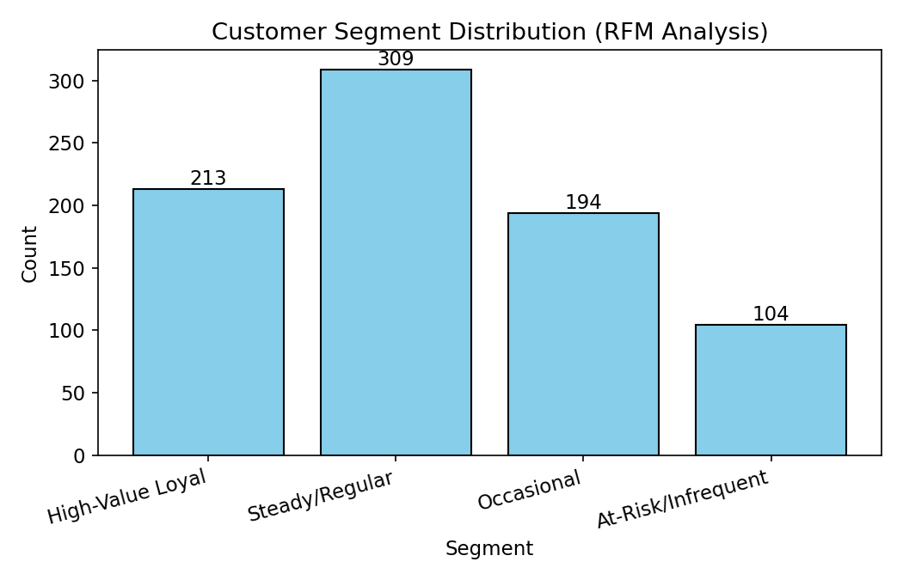
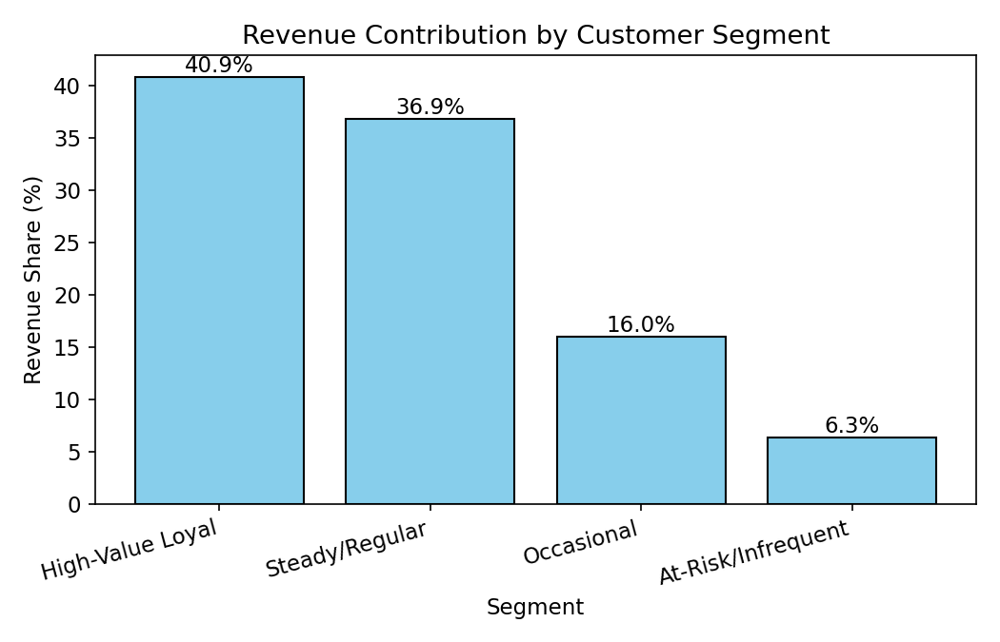
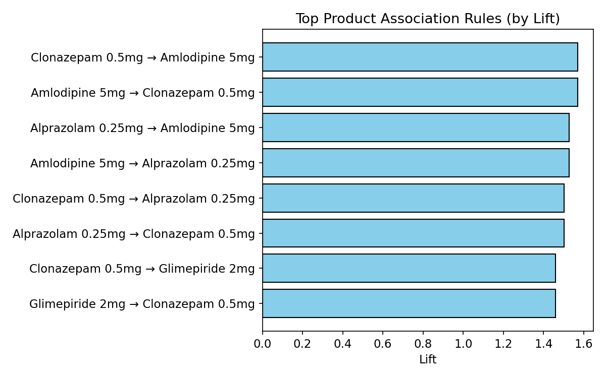
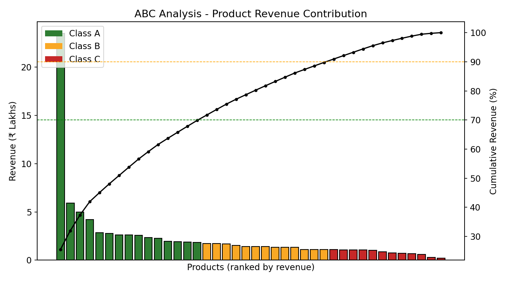
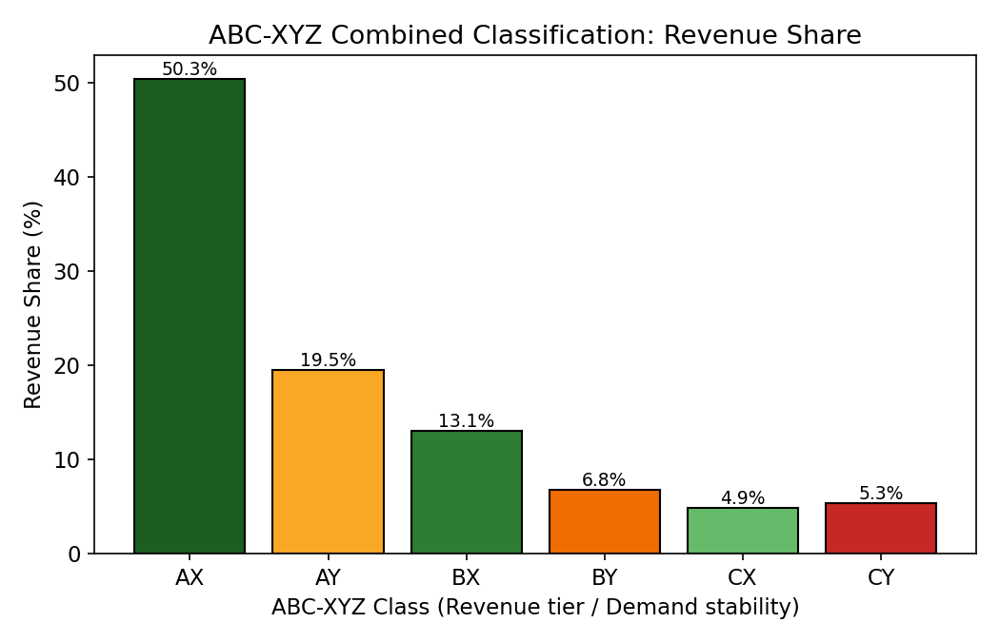
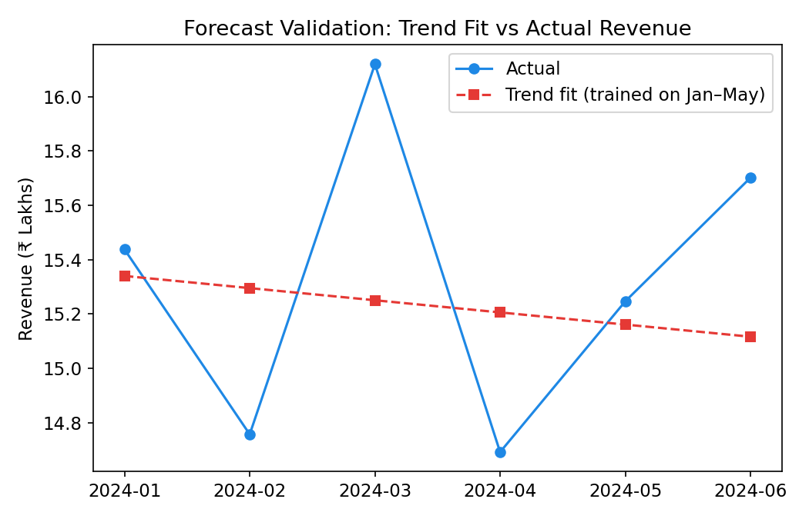
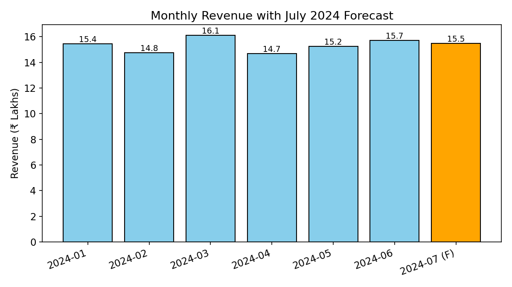

# Utilizing Sales Pattern Analytics to Customize Marketing and Optimize Stock at a Pharmacy

BDM Capstone Project, IITM Online BS Degree Program.

Six months of a Bengaluru retail pharmacy's own billing data (1 Jan - 30 Jun 2024; 25,512 transaction lines, 13,355 invoices, 820 customers, 40 products) analysed to answer three business questions:

1. How do customers buy and re-buy? (purchase trends and repeat behaviour)
2. Which customers deserve targeted marketing? (customer categorisation)
3. What should be stocked and promoted together? (inventory planning and cross-selling)

## Methods

| Analysis | Technique |
|---|---|
| Customer segmentation | RFM (Recency, Frequency, Monetary) quartile scoring into four segments |
| Cross-selling | Market basket analysis with the Apriori algorithm (support, confidence, lift) |
| Inventory priority | ABC revenue classification combined with XYZ demand-variability (ABC-XYZ) |
| Forecasting | Linear trend, validated on a held-out month (MAE, MAPE) |
| Safety stock | Safety stock and reorder points for high-revenue, unstable-demand products |

The capstone analysis was run in Python (pandas, NumPy, mlxtend, Matplotlib), with results consolidated in an Excel workbook.

## Headline findings

- **Revenue and customers are concentrated.** 213 High-Value Loyal customers (25.98% of the base) generate 40.85% of revenue. Together with the Steady/Regular segment they account for 77.70% of revenue from 63.66% of customers.
- **15 of 40 products (Class A) drive 69.85% of revenue.** Five of them combine high revenue with unstable demand and are the biggest stock-out risk.
- **Chronic-therapy medicines are bought together.** Eight product pairs show lift between 1.42 and 1.57, a basis for bundled refill reminders.
- **Overall revenue is forecastable; categories less so.** The hold-out MAPE for total monthly revenue is 3.73%, but Vitamins, Respiratory and Skin Care forecasts are unreliable with only six months of history.

## Results at a glance

Charts from the final report (real, aggregated results).

**Customer segmentation (RFM)**

<p>
  
  
</p>

**Products bought together (market basket analysis)**

<p>
  
</p>

**Inventory priority (ABC and ABC-XYZ)**

<p>
  
  
</p>

**Forecasting (hold-out validation and July projection)**

<p>
  
  
</p>

## Repository contents

| File | What it is |
|---|---|
| [BDM_Capstone_Final_Report.pdf](BDM_Capstone_Final_Report.pdf) | Final capstone report: methods, results, recommendations |
| [BDM_Capstone_Presentation.pdf](BDM_Capstone_Presentation.pdf) | Presentation slides |
| [Pharmacy_Sales_Analysis_DataFree.xlsx](Pharmacy_Sales_Analysis_DataFree.xlsx) | Analysis workbook with all result tables and charts. Transaction-level data removed. |
| [analysis_pipeline.ipynb](analysis_pipeline.ipynb) | Reproducible pipeline (RFM, Apriori, ABC-XYZ, forecast, safety stock) running on a **synthetic** dataset with the same structure |
| [requirements.txt](requirements.txt) | Python dependencies for the notebook |
| [LICENSE-CODE](LICENSE-CODE) | MIT licence for the notebook code |

## Run the notebook

```bash
pip install -r requirements.txt
jupyter notebook analysis_pipeline.ipynb
```

The real transaction data cannot be published, so the notebook generates a synthetic dataset (fixed random seed) with the same columns and runs the full pipeline on it. It is an illustrative re-implementation of the method, **not the original analysis code**, and its numbers differ from the report above - for example, the RFM segment cut-offs are illustrative choices. To use it on your own data, replace the data-generation cell with a dataframe that has the same columns.

## Confidentiality

The transaction data was supplied by the business under written authorisation for **academic use only**, with a commitment that confidential information would not be disclosed to third parties. To honour that:

- The business's name, address and shopfront photo are **redacted** from the report and slides (shown as `[Pharmacy]`, `[Area]` and "Photo redacted").
- The raw transaction data, customer names, phone numbers and customer IDs are **not included**. In the workbook, cells that originally read from the removed data hold their computed values; downstream formulas (cumulative share, ABC/XYZ class, support/confidence/lift, trend fit, MAPE, safety stock) remain live.

## Licence

The code in `analysis_pipeline.ipynb` and `requirements.txt` is released under the MIT licence (see [LICENSE-CODE](LICENSE-CODE)). The report, slides, workbook and charts are shared for viewing only; they are (c) 2026 Abhishek Ramesh Kumar, all rights reserved, and are not covered by that licence.

## Disclaimer

This is an academic project. Its recommendations are specific to the business studied and are not endorsed by IIT Madras.

## Author

Abhishek Ramesh Kumar - [GitHub](https://github.com/AbhishekRK41)
